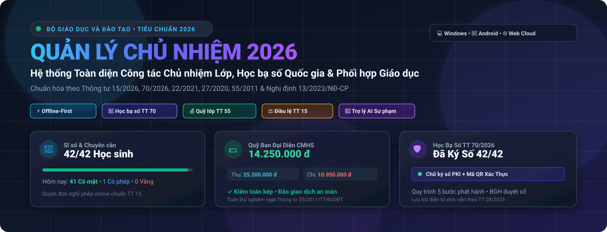
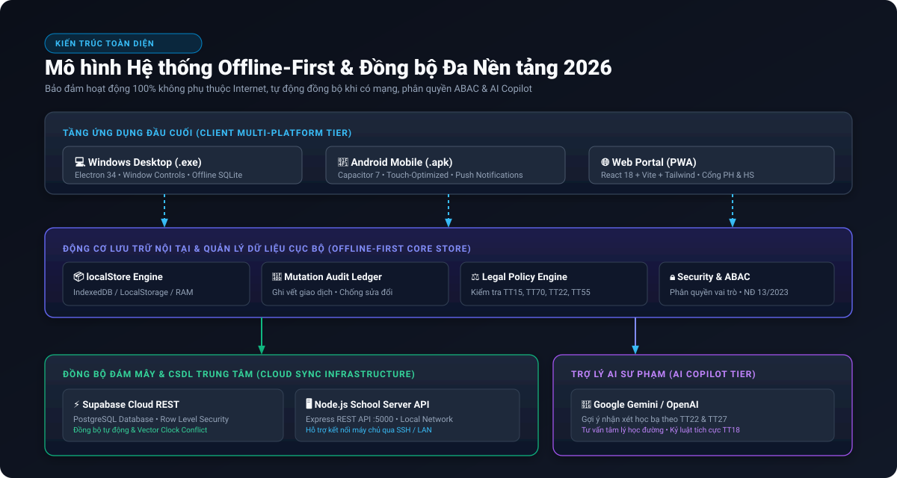
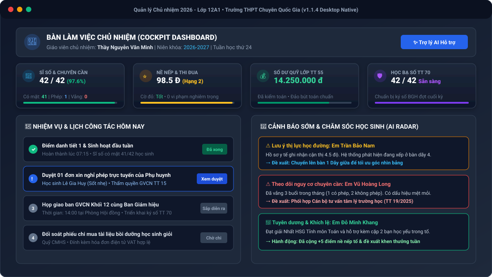
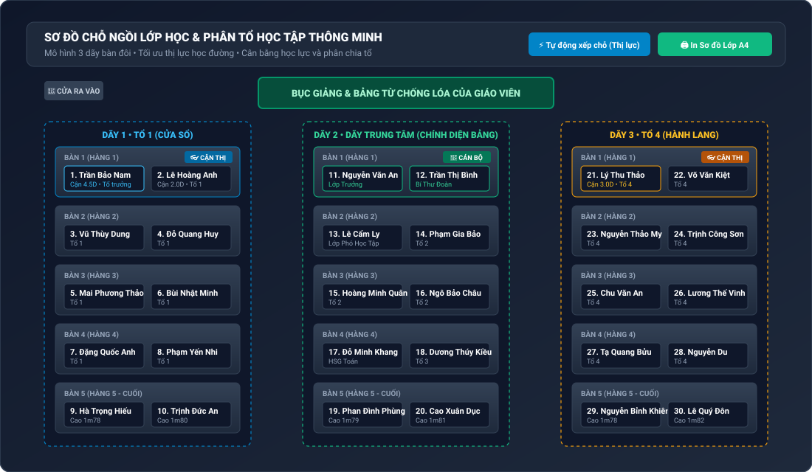
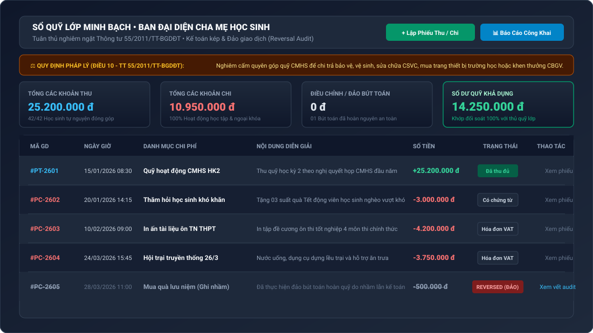
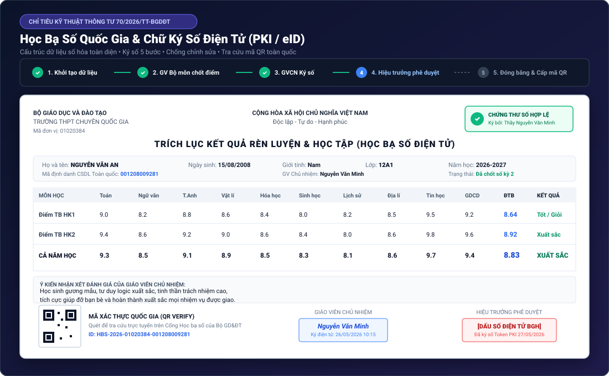
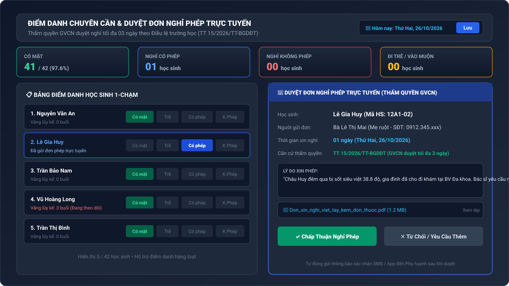
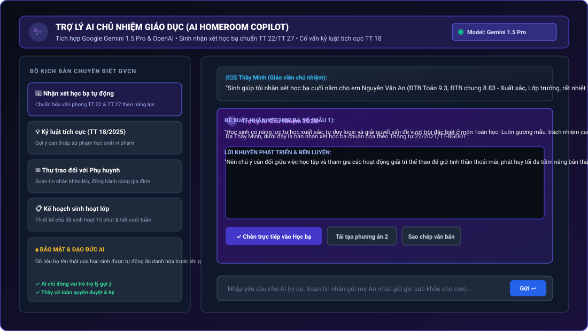

# 🏫 HỆ THỐNG QUẢN LÝ CHỦ NHIỆM & HỌC BẠ SỐ TOÀN TRƯỜNG 2026
### *Nền tảng Chuyển đổi số Công tác Chủ nhiệm Lớp, Học bạ số Quốc gia & Phối hợp Giáo dục Đa Nền tảng*

<div align="center">



[](https://github.com/dsnbw/quan-ly-chu-nhiem-2026/releases)
[](https://github.com/dsnbw/quan-ly-chu-nhiem-2026)
[](https://github.com/dsnbw/quan-ly-chu-nhiem-2026)
[](https://github.com/dsnbw/quan-ly-chu-nhiem-2026)
[](https://moet.gov.vn)
[](LICENSE)

**[🌐 Trải nghiệm Web](https://github.com/dsnbw/quan-ly-chu-nhiem-2026)** • **[💻 Bản Cài Desktop (.exe)](https://github.com/dsnbw/quan-ly-chu-nhiem-2026/releases)** • **[📱 Tải App Android (.apk)](https://github.com/dsnbw/quan-ly-chu-nhiem-2026/releases/download/v1.1.4/quan-ly-chu-nhiem-2026-v1.1.4.apk)** • **[📖 Tài liệu Kỹ thuật](Ke_hoach_he_thong_quan_ly_chu_nhiem_toan_truong_2026.md)**

---

</div>

## 📌 MỤC LỤC TỔNG QUAN

1. [🌟 Giới thiệu Sứ mệnh & Bối cảnh](#-giới-thiệu-sứ-mệnh--bối-cảnh)
2. [⚖️ Căn cứ Pháp lý & Chuẩn mực Giáo dục 2026](#️-căn-cứ-pháp-lý--chuẩn-mực-giáo-dục-2026)
3. [🏗️ Kiến trúc Kỹ thuật & Công nghệ (Offline-First)](#️-kiến-trúc-kỹ-thuật--công-nghệ-offline-first)
4. [🚀 16 Phân hệ Tính năng Toàn diện (Kèm Minh Họa Sắc Nét)](#-16-phân-hệ-tính-năng-toàn-diện)
   - [4.1. Bàn làm việc Chủ nhiệm (Cockpit Dashboard)](#41-bàn-làm-việc-chủ-nhiệm-cockpit-dashboard)
   - [4.2. Sơ đồ Lớp học 3 Dãy Bàn Đôi & Tối ưu Thị lực](#42-sơ-đồ-lớp-học-3-dãy-bàn-đôi--tối-ưu-thị-lực)
   - [4.3. Sổ Quỹ Lớp Minh Bạch & Kế toán Kép (TT 55/2011)](#43-sổ-quỹ-lớp-minh-bạch--kế-toán-kép-tt-552011)
   - [4.4. Học Bạ Số Quốc Gia & Ký Số Điện Tử (TT 70/2026)](#44-học-bạ-số-quốc-gia--ký-số-điện-tử-tt-702026)
   - [4.5. Điểm danh Chuyên cần & Duyệt Đơn Nghỉ Phép (TT 15/2026)](#45-điểm-danh-chuyên-cần--duyệt-đơn-nghỉ-phép-tt-152026)
   - [4.6. Trợ lý AI Giáo dục Sư phạm (AI Homeroom Copilot)](#46-trợ-lý-ai-giáo-dục-sư-phạm-ai-homeroom-copilot)
   - [4.7. Các Phân hệ Nghiệp vụ Bổ trợ Cốt lõi](#47-các-phân-hệ-nghiệp-vụ-bổ-trợ-cốt-lõi)
5. [💻 Hướng dẫn Cài đặt & Triển khai Chi tiết](#-hướng-dẫn-cài-đặt--triển-khai-chi-tiết)
   - [Chạy Web Localhost](#cách-1-chạy-phiên-bản-web-nhanh)
   - [Chạy Windows Desktop (.exe)](#cách-2-ứng-dụng-windows-desktop-electron)
   - [Cài đặt & Build Android (.apk)](#cách-3-ứng-dụng-di-động-android-apk)
   - [Cấu hình Backend & Supabase Cloud Sync](#cách-4-cấu-hình-đồng-bộ-đám-mây-supabase--server-api)
6. [📚 Hướng dẫn Sử dụng Theo Kịch bản Thực tế](#-hướng-dẫn-sử-dụng-theo-kịch-bản-thực-tế)
7. [🛡️ An toàn Thông tin & Quyền Riêng tư (NĐ 13/2023/NĐ-CP)](#️-an-toàn-thông-tin--quyền-riêng-tư-nđ-132023nđ-cp)
8. [❓ Câu hỏi Thường gặp (FAQ)](#-câu-hỏi-thường-gặp-faq)
9. [🤝 Đóng góp Phát triển & Giấy phép](#-đóng-góp-phát-triển--giấy-phép)

---

## 🌟 GIỚI THIỆU SỨ MỆNH & BỐI CẢNH

Công tác giáo viên chủ nhiệm (GVCN) tại các cơ sở giáo dục phổ thông Việt Nam luôn giữ vai trò "linh hồn" trong việc kết nối giữa **Nhà trường - Gia đình - Xã hội**. Tuy nhiên, thầy cô chủ nhiệm thường xuyên phải đối mặt với áp lực quá tải:
- Hàng chục loại sổ sách thủ công trùng lặp (sổ chủ nhiệm, sổ điểm, sổ nề nếp, sổ liên lạc, phiếu thu chi...).
- Nỗi lo sai sót pháp lý trong thu chi quỹ lớp và đánh giá học bạ số.
- Khó khăn khi mạng Internet tại trường học chập chờn, không thể điểm danh hay tra cứu hồ sơ kịp thời.
- Thiếu công cụ cảnh báo sớm các nguy cơ tâm lý, học lực và chuyên cần của học sinh.

**Quản lý Chủ nhiệm 2026** ra đời như một **giải pháp chuyển đổi số toàn diện**, được thiết kế dựa trên triết lý **Offline-First**, bảo đảm:
1. **Hoạt động trơn tru 100% không phụ thuộc Internet**, tự động đồng bộ khi có kết nối mạng.
2. **Tuân thủ tuyệt đối hành lang pháp lý giáo dục 2026** của Bộ Giáo dục và Đào tạo và Chính phủ Việt Nam.
3. **Giảm thiểu hơn 70% thời gian xử lý thủ tục hành chính**, giúp thầy cô dành trọn tâm huyết cho công tác giáo dục và đồng hành cùng học sinh.
4. **Tích hợp Trợ lý AI Sư phạm**, hỗ trợ sinh nhận xét cá nhân hóa, gợi ý phương pháp kỷ luật tích cực và giải pháp sư phạm chuẩn mực.

---

## ⚖️ CĂN CỨ PHÁP LÝ & CHUẨN MỰC GIÁO DỤC 2026

Toàn bộ logic nghiệp vụ, thuật toán tính toán và mẫu biểu báo cáo của hệ thống được lập trình tuân thủ nghiêm ngặt hệ thống văn bản quy phạm pháp luật hiện hành:

| Văn bản Pháp luật | Cơ quan Ban hành | Phạm vi Điều chỉnh & Giải pháp trong Hệ thống |
|---|---|---|
| **Thông tư 15/2026/TT-BGDĐT** | Bộ Giáo dục và Đào tạo | **Điều lệ trường THCS, THPT:** Quy định rõ quyền hạn GVCN được phép duyệt đơn xin nghỉ học của học sinh **tối đa 03 ngày liên tục**; quyền tự chủ tổ chức lớp học và phân công ban cán sự. |
| **Thông tư 70/2026/TT-BGDĐT** | Bộ Giáo dục và Đào tạo | **Quy chuẩn kỹ thuật Học bạ số Quốc gia:** Chuẩn hóa dữ liệu có cấu trúc JSON-Schema, quy trình **ký số điện tử 5 bước** (PKI / Căn cước điện tử), đóng dấu thời gian (Timestamp) và mã QR xác thực tra cứu toàn quốc. |
| **Thông tư 22/2021/TT-BGDĐT** | Bộ Giáo dục và Đào tạo | **Đánh giá học sinh THCS và THPT:** Quy định tính điểm thường xuyên, giữa kỳ, cuối kỳ, tính ĐTB, kết hợp đánh giá bằng nhận xét và điểm số; phân loại 4 mức: *Tốt, Khá, Đạt, Chưa đạt*. |
| **Thông tư 27/2020/TT-BGDĐT** | Bộ Giáo dục và Đào tạo | **Đánh giá học sinh Tiểu học:** Đánh giá định kỳ vì sự tiến bộ của học sinh, coi trọng động viên khích lệ, ghi nhận sự tiến bộ về năng lực cốt lõi và phẩm chất chủ yếu. |
| **Thông tư 55/2011/TT-BGDĐT** | Bộ Giáo dục và Đào tạo | **Điều lệ Ban đại diện Cha mẹ học sinh:** Quản lý quỹ hội phụ huynh công khai minh bạch; **nghiêm cấm tuyệt đối lạm thu** (Điều 10 cấm thu chi trả bảo vệ, vệ sinh trường, sửa chữa CSVC trường, khen thưởng CBGV). Bắt buộc kiểm toán kép và đảo bút toán minh bạch. |
| **Thông tư 08/2025/TT-BGDĐT** | Bộ Giáo dục và Đào tạo | **Quy định thời hạn bảo quản hồ sơ, tài liệu giáo dục:** Hồ sơ học bạ, bảng điểm tổng hợp và sổ đăng bộ lưu trữ điện tử vĩnh viễn với cơ chế bảo vệ tính toàn vẹn dữ liệu. |
| **Thông tư 18/2025 & TT 19/2025** | Bộ Giáo dục và Đào tạo | **Kỷ luật tích cực & Tư vấn tâm lý học đường:** Nghiêm cấm xử phạt xúc phạm nhân phẩm; khuyến khích các biện pháp giáo dục tích cực, xây dựng hồ sơ can thiệp tâm lý học đường bảo mật. |
| **Nghị định 13/2023/NĐ-CP** | Chính phủ | **Bảo vệ dữ liệu cá nhân:** Bảo vệ tuyệt đối thông tin cá nhân của học sinh (CCCD, địa chỉ cư trú, hồ sơ bệnh án, hoàn cảnh gia đình). Mã hóa cục bộ và phân quyền truy cập nghiêm ngặt. |

---

## 🏗️ KIẾN TRÚC KỸ THUẬT & CÔNG NGHỆ (OFFLINE-FIRST)

Hệ thống được phát triển theo mô hình **Tam giác Ứng dụng Toàn diện (Desktop - Mobile - Web)** trên nền tảng kiến trúc **Offline-First Reactive Core**:



### Điểm nhấn Công nghệ:
1. **Offline-First Reactive Core (`src/core/storage/localStore.ts`)**:
   - Sử dụng cơ chế lưu trữ IndexedDB kết hợp LocalStorage và Memory Cache đa tầng.
   - Toàn bộ thao tác (điểm danh, nhập điểm, ghi sổ quỹ, chia tổ) được ghi trực tiếp vào cơ sở dữ liệu nội tại trên thiết bị với độ trễ < 1ms.
   - Hàng đợi biến đổi dữ liệu (Mutation Action Queue) tự động ghi nhận mọi thay đổi kèm chữ ký kiểm toán (Audit Hash).
2. **Đồng bộ Đám mây Thông minh (`src/core/sync/CloudSyncClient.ts`)**:
   - Hỗ trợ kết nối đồng thời với **Supabase Cloud (PostgreSQL REST + RLS Policies)**, **Firebase** và **Máy chủ Node.js Express chuyên dụng (Port 5000)** qua kênh bảo mật SSH / TLS.
   - Giải quyết xung đột dữ liệu bằng thuật toán **Vector Clock / Last-Write-Wins có Ledger kiểm toán**, bảo đảm không bao giờ ghi đè dữ liệu của nhau khi nhiều giáo viên cùng thao tác.
3. **Đa nền tảng Native**:
   - **Windows Desktop:** Đóng gói bằng **Electron 34**, tích hợp các phím tắt chuyên dụng, nút điều khiển cửa sổ native (Minimize, Maximize, Close), tự động cập nhật và chạy mượt mà ngay cả trên máy tính phòng học không có Internet.
   - **Android Mobile:** Biên dịch bằng **Capacitor 7**, tối ưu hóa cử chỉ cảm ứng 1 chạm, hỗ trợ điểm danh nhanh trên lớp học hoặc sân trường.
   - **Web Portal:** Tối ưu hóa bằng **Vite + React 18 + Tailwind CSS**, tải siêu nhanh, hỗ trợ PWA cài đặt trực tiếp trên trình duyệt.

---

## 🚀 16 PHÂN HỆ TÍNH NĂNG TOÀN DIỆN

---

### 4.1. Bàn làm việc Chủ nhiệm (Cockpit Dashboard)

Bàn điều khiển trung tâm giúp giáo viên chủ nhiệm nắm bắt toàn bộ bức tranh của lớp học trong vòng 3 giây:



- **KPI Thời gian thực:**
  - Sĩ số lớp, phân chia giới tính (Nam/Nữ) và tỷ lệ chuyên cần tính đến thời điểm hiện tại.
  - Điểm thi đua nề nếp tuần và thứ hạng của lớp trong toàn trường.
  - Số dư quỹ Ban đại diện cha mẹ học sinh khả dụng thực tế sau đối soát.
  - Tiến độ hoàn thiện và ký số học bạ số quốc gia.
- **Lịch trình & Nhiệm vụ hôm nay:** Tự động tổng hợp các việc cần làm (điểm danh tiết 1, duyệt đơn nghỉ phép trực tuyến, họp BGH, đối soát hóa đơn...).
- **Radar Cảnh báo sớm Sư phạm (AI Early Warning):**
  - Cảnh báo học sinh có tật khúc xạ (cận thị nặng) bị xếp ngồi sai vị trí bàn học.
  - Cảnh báo học sinh có nguy cơ vắng học vượt quá 3 buổi/tháng hoặc dấu hiệu sa sút học lực.
  - Gợi ý biểu dương, khích lệ các học sinh có tiến bộ vượt bậc hoặc đạt thành tích xuất sắc.

---

### 4.2. Sơ đồ Lớp học 3 Dãy Bàn Đôi & Tối ưu Thị lực

Mô phỏng chân thực và khoa học không gian phòng học tiêu chuẩn của trường phổ thông Việt Nam:



- **Mô hình 3 Dãy Bàn Đôi Chuẩn Hóa:**
  - Gồm 3 dãy (Dãy Trái cửa sổ, Dãy Giữa chính diện bục giảng, Dãy Phải hành lang).
  - Mỗi dãy gồm 5 hàng bàn đôi, cung cấp sức chứa linh hoạt lên đến 30 bàn (60 chỗ ngồi).
- **Thuật toán Tự động Xếp chỗ Thông minh:**
  - **Ưu tiên Thị lực:** Tự động quét hồ sơ y tế học sinh; học sinh cận thị nặng hoặc có vấn đề thị giác được ưu tiên xếp vào Bàn 1 và Bàn 2 dãy trung tâm/trái để chống lóa mắt.
  - **Cân bằng Chiều cao:** Học sinh có chiều cao vượt trội tự động xếp về các hàng cuối (Bàn 4, Bàn 5) để không che khuất tầm nhìn bảng đen của bạn phía sau.
  - **Cân bằng Học lực & Giới tính:** Phân bổ đều học sinh khá giỏi kèm cặp học sinh cần hỗ trợ, cân bằng tỷ lệ nam/nữ trong từng tổ.
- **Thao tác 1 chạm:** Kéo thả linh hoạt hoán đổi 2 học sinh, xoay vòng bàn học định kỳ tuần/tháng để chống vẹo cột sống và tật khúc xạ một bên.
- **Xuất bản in A4:** Xuất sơ đồ lớp học ra file PDF/In ấn A4 chuẩn chỉnh để dán tại bục giảng cho giáo viên bộ môn theo dõi.

---

### 4.3. Sổ Quỹ Lớp Minh Bạch & Kế toán Kép (TT 55/2011)

Chấm dứt hoàn toàn tình trạng mập mờ, mất niềm tin và nỗi lo lạm thu trong trường học:



- **Bộ lọc Pháp lý Tự động (Điều 10 - TT 55/2011/TT-BGDĐT):**
  - Hệ thống tự động chặn và hiển thị cảnh báo đỏ nếu người dùng nhập các khoản thu chi trái quy định: *thu tiền bảo vệ, vệ sinh trường lớp, sửa chữa cơ sở vật chất, mua sắm máy móc thiết bị nhà trường, khen thưởng cán bộ quản lý/giáo viên*.
- **Cơ chế Kế toán Kép & Bút toán Đảo (Reversal Audit Ledger):**
  - Tuyệt đối không xóa cứng dữ liệu giao dịch đã lập để chống gian lận.
  - Khi phát hiện sai sót, hệ thống tạo một bút toán đảo ngược (`REVERSAL`) đối ứng, tự động hoàn trả số dư thực tế và khôi phục hạn mức công nợ của học sinh tương ứng.
- **Đối soát Công nợ Từng Học sinh:** Bảng danh sách theo dõi chi tiết số tiền đã đóng, miễn giảm cho học sinh có hoàn cảnh khó khăn và số dư còn lại.
- **Báo cáo Tài chính Công khai:** Tạo tức thời bảng sao kê thu chi kèm mã QR để gửi phụ huynh học sinh kiểm tra trực tiếp trên điện thoại.

---

### 4.4. Học Bạ Số Quốc Gia & Ký Số Điện Tử (TT 70/2026)

Triển khai toàn diện chuyển đổi số học bạ học sinh theo quy chuẩn quốc gia 2026:



- **Quy trình Ký số 5 Bước Khép kín:**
  1. *Khởi tạo dữ liệu:* Tập hợp điểm số và nhận xét từ các giáo viên bộ môn.
  2. *GVBM chốt điểm:* Xác nhận bảng điểm thành phần bộ môn không còn điều chỉnh.
  3. *GVCN Ký số:* Ký số điện tử (Digital Signature - PKI Token/Căn cước eID) vào hồ sơ chủ nhiệm.
  4. *Hiệu trưởng Phê duyệt:* Ban Giám hiệu kiểm duyệt và đóng dấu số điện tử nhà trường.
  5. *Đóng băng & Cấp mã QR:* Cấp mã định danh học bạ số quốc gia và mã QR tra cứu toàn quốc.
- **Mã QR Xác thực Chống Giả mạo:** Mỗi trích lục học bạ số được mã hóa bằng thuật toán băm (SHA-256) và gắn mã QR duy nhất, cho phép quét trên Cổng Dữ liệu Giáo dục Quốc gia để đối soát tức thì.
- **Lưu trữ Vĩnh viễn (TT 08/2025):** Tự động đóng băng dữ liệu sau khi ký số, ngăn chặn mọi hành vi can thiệp sửa điểm trái phép.

---

### 4.5. Điểm danh Chuyên cần & Duyệt Đơn Nghỉ Phép (TT 15/2026)

Số hóa quy trình điểm danh đầu giờ và tiếp nhận đơn xin nghỉ phép của phụ huynh:



- **Điểm danh 1 chạm Thông minh:**
  - 4 trạng thái chuẩn hóa: **Có mặt** (Xanh lá), **Đi trễ** (Vàng), **Có phép** (Xanh lam), **Không phép** (Đỏ).
  - Hỗ trợ điểm danh hàng loạt theo tổ hoặc theo toàn lớp trong vòng 5 giây.
- **Cổng Duyệt Đơn Nghỉ Phép Trực Tuyến (TT 15/2026):**
  - Phụ huynh gửi đơn xin nghỉ trực tiếp từ điện thoại kèm lý do và ảnh minh chứng (giấy khám sức khỏe, đơn viết tay).
  - Phân định rõ thẩm quyền: **GVCN có thẩm quyền duyệt tối đa 03 ngày liên tục**; các trường hợp nghỉ trên 3 ngày tự động chuyển tiếp lên Ban Giám hiệu phê duyệt.
- **Hệ thống Cảnh báo Chuyên cần Lũy kế:** Tự động đếm số buổi vắng học trong học kỳ, cảnh báo khi học sinh vắng gần ngưỡng quy định (nghỉ quá 45 buổi trong một năm học không được lên lớp).

---

### 4.6. Trợ lý AI Giáo dục Sư phạm (AI Homeroom Copilot)

Đồng hành cùng giáo viên chủ nhiệm như một chuyên gia sư phạm và tâm lý học đường:



- **Sinh Nhận xét Học bạ Chuẩn hóa TT 22 & TT 27:**
  - Phân tích điểm số, hạnh kiểm và đặc thù năng lực của từng học sinh để tạo ra lời nhận xét sâu sắc, động viên, tránh nhận xét sáo rỗng hoặc rập khuôn.
  - Giáo viên có thể duyệt, chỉnh sửa hoặc chèn trực tiếp 1 chạm vào Học bạ số.
- **Cố vấn Kỷ luật Tích cực (Thông tư 18/2025/TT-BGDĐT):**
  - Gợi ý các biện pháp xử lý vi phạm nề nếp theo nguyên tắc tôn trọng nhân phẩm, hướng dẫn học sinh nhận thức sai lầm và khắc phục tích cực.
- **Soạn Thảo Thông Điệp Tinh Tế với Phụ Huynh:**
  - Tự động tạo bản nháp tin nhắn thông báo tình hình học tập hoặc sự việc trên lớp với ngôn phong chân thành, xây dựng mối quan hệ đồng hành tin cậy với gia đình.
- **Ẩn danh Hóa Dữ liệu (Bảo mật Nghị định 13/2023):** Mọi thông tin nhạy cảm của học sinh đều được ẩn danh hóa trước khi gửi tới API ngôn ngữ lớn (Google Gemini / OpenAI).

---

### 4.7. Các Phân hệ Nghiệp vụ Bổ trợ Cốt lõi

Ngoài 6 phân hệ lớn trên, hệ thống tích hợp đầy đủ 10 phân hệ nghiệp vụ không thể thiếu:

7. **Hồ sơ Học sinh Điện tử (Student Registry):** Quản lý lý lịch trích ngang, số định danh cá nhân (CCCD), BHYT, địa chỉ cư trú, thông tin cha mẹ, phân loại diện chính sách, hộ nghèo, học sinh khuyết tật học hòa nhập.
8. **Sổ Điểm Điện tử & Đánh giá Rèn luyện (Gradebook):** Bảng điểm các môn học theo Thông tư 22/2021 và 27/2020. Tự động tính điểm trung bình học kỳ, cả năm theo đúng hệ số môn học; xếp loại học lực và rèn luyện.
9. **Nhật ký Nề nếp & Thi đua Cờ đỏ (Behavior Ledger):** Ghi chép nhật ký vi phạm và khen thưởng hàng ngày; chấm điểm thi đua giữa các tổ; tự động trừ điểm theo quy ước nội bộ.
10. **Sổ Chủ nhiệm Số (Digital Homeroom Book):** Thay thế hoàn toàn sổ chủ nhiệm giấy: kế hoạch công tác tháng, nghị quyết họp phụ huynh, sơ yếu lý lịch cán bộ lớp, biên bản bàn giao.
11. **Tư vấn Tâm lý Học đường & Can thiệp Sớm (TT 19/2025):** Nhật ký theo dõi các trường hợp học sinh gặp vấn đề tâm lý, khó khăn học tập hoặc xung đột bạn bè, bảo đảm bảo mật tuyệt đối.
12. **Cổng Thông tin Phụ huynh (Parent Portal):** Kênh tương tác dành cho cha mẹ: tra cứu điểm danh, điểm kiểm tra, nhận thông báo của GVCN và gửi đơn xin nghỉ trực tuyến.
13. **Cổng Thông tin Học sinh (Student Portal):** Học sinh theo dõi điểm rèn luyện, nhiệm vụ học tập được giao, thời khóa biểu và mục tiêu cá nhân.
14. **Lịch Công tác & Nhiệm vụ Chủ nhiệm (TaskManager):** Lịch trình làm việc tuần/tháng, nhắc việc tự động chuẩn bị các mốc sơ kết, họp phụ huynh, nộp báo cáo chuyên đề.
15. **Trung tâm Báo cáo & Xuất DOCX / XLSX / PDF (ReportCenter):** Tạo tức thì các biểu mẫu thống kê định kỳ gửi BGH: Báo cáo chuyên cần tháng, Sơ kết học kỳ, Bảng tổng hợp điểm xuất ra file Word (.docx), Excel (.xlsx) chuẩn mẫu phông chữ hành chính.
16. **Trung tâm Cấu hình & Sao lưu Hệ thống (Settings & Sync):** Quản lý tài khoản phân quyền ABAC/RBAC, cấu hình khóa học, sao lưu toàn bộ dữ liệu ra tệp JSON (`Full Backup`) và khôi phục khi chuyển máy.

---

## 💻 HƯỚNG DẪN CÀI ĐẶT & TRIỂN KHAI CHI TIẾT

### Yêu cầu Hệ thống:
- **Node.js:** Phiên bản 18.x trở lên (khuyên dùng Node.js 20 LTS).
- **Hệ điều hành:** Windows 10/11, macOS 12+, Ubuntu 20.04+, hoặc Android 8.0+.
- **Trình duyệt:** Google Chrome, Microsoft Edge, Firefox hoặc Safari phiên bản mới nhất.

---

### Cách 1: Chạy Phiên bản Web Nhanh

Phù hợp cho việc thử nghiệm, phát triển hoặc sử dụng trên trình duyệt máy tính:

```bash
# 1. Clone mã nguồn từ GitHub
git clone https://github.com/dsnbw/quan-ly-chu-nhiem-2026.git
cd quan-ly-chu-nhiem-2026

# 2. Cài đặt các gói phụ thuộc
npm install

# 3. Khởi chạy môi trường phát triển Vite
npm run dev
```

Sau khi khởi chạy, mở trình duyệt và truy cập: **`http://localhost:5173`**

---

### Cách 2: Ứng dụng Windows Desktop (Electron)

Dành cho giáo viên chủ nhiệm cài đặt trực tiếp lên Laptop / PC để sử dụng offline tuyệt đối trong lớp học:

```bash
# Chạy thử nghiệm ứng dụng Desktop ở chế độ lập trình
npm run electron:dev

# Biên dịch bộ cài đặt Windows Setup (.exe) hoàn chỉnh
npm run electron:build
```

> **Thành phẩm:** Tệp cài đặt Windows Setup `.exe` sẽ được tạo ra tại thư mục `dist_electron/`. Nhấp đúp chuột để cài đặt và sử dụng độc lập không cần chạy lệnh.

---

### Cách 3: Ứng dụng Di động Android (.apk)

Dành cho giáo viên chủ nhiệm và phụ huynh thao tác trên điện thoại thông minh:

```bash
# 1. Biên dịch mã nguồn Web
npm run build

# 2. Đồng bộ mã nguồn vào dự án Android Native
npx cap sync android

# 3. Mở dự án trong Android Studio để build hoặc chạy thử
npx cap open android
```

> **Tải nhanh:** Nếu không muốn biên dịch mã nguồn, bạn có thể tải trực tiếp tệp cài đặt chính thức:  
> 📥 **[Tải App Android APK v1.1.4 (quan-ly-chu-nhiem-2026-v1.1.4.apk)](https://github.com/dsnbw/quan-ly-chu-nhiem-2026/releases/download/v1.1.4/quan-ly-chu-nhiem-2026-v1.1.4.apk)**

---

### Cách 4: Cấu hình Đồng bộ Đám mây (Supabase / Server API)

Để dữ liệu tự động đồng bộ giữa điện thoại của GVCN, máy tính ở nhà và cổng thông tin phụ huynh:

#### 1. Cấu hình Biến môi trường (`.env`):
Tạo tệp `.env` tại thư mục gốc của dự án:
```env
# URL kết nối Supabase Cloud
VITE_SUPABASE_URL=https://your-project.supabase.co
VITE_SUPABASE_ANON_KEY=your-anon-public-key

# API Server Node.js của trường học (tùy chọn)
VITE_SCHOOL_API_URL=http://localhost:5000/api/v1

# API Key Trợ lý AI (Google Gemini hoặc OpenAI)
VITE_GEMINI_API_KEY=AIzaSyYourGeminiApiKeyHere
VITE_OPENAI_API_KEY=sk-proj-YourOpenAiApiKeyHere
```

#### 2. Khởi chạy Backend Server Node.js (Nếu dùng Server nội bộ):
```bash
node backend/server.js
# Server chạy tại port 5000 (Kiểm tra ping: http://localhost:5000/ping)
```

---

## 📚 HƯỚNG DẪN SỬ DỤNG THEO KỊCH BẢN THỰC TẾ

### Kịch bản 1: Đầu Năm Học (Khởi tạo Lớp học Mới)
1. **Nhập Sĩ số Lớp:** Vào mục **Hồ sơ Học sinh** -> Nhấp **"Thêm học sinh"** để nhập thủ công hoặc tải file Excel mẫu danh sách lớp vào hệ thống.
2. **Cấu hình Sơ đồ Lớp:** Vào mục **Sơ đồ Chỗ ngồi** -> Nhấp nút **"⚡ Tự động xếp chỗ"**. Hệ thống sẽ tự động quét tật khúc xạ (cận thị) để xếp lên bàn đầu và cân đối chiều cao về các hàng cuối.
3. **Phân Tổ & Ban Cán sự:** Chỉ định Lớp trưởng, Bí thư, Tổ trưởng ngay trên thẻ học sinh.
4. **Lập Kế hoạch Quỹ Lớp:** Vào mục **Quỹ Lớp** -> Nhấp **"+ Lập Phiếu Thu / Chi"** để lập danh mục các khoản tự nguyện đầu năm theo đúng phê duyệt của cuộc họp phụ huynh đầu khóa.

### Kịch bản 2: Vận Hành Hàng Ngày & Hàng Tuần
1. **Điểm danh Đầu giờ (07:15):** Mở ứng dụng điện thoại hoặc Desktop -> Vào mục **Điểm danh** -> Mặc định cả lớp là **Có mặt**, chỉ cần nhấp vào các bạn nghỉ để đổi thành **Trễ / Có phép / Không phép** trong vòng 10 giây.
2. **Duyệt Đơn Nghỉ Phép Trực Tuyến:** Kiểm tra danh sách đơn phụ huynh gửi. Xem lý do và giấy khám đính kèm -> Nhấp **"Chấp thuận nghỉ phép"** (chuẩn thẩm quyền GVCN tối đa 3 ngày theo TT 15/2026).
3. **Ghi Nhận Nề nếp & Khen thưởng:** Vào mục **Nề nếp** để cộng điểm khích lệ học sinh phát biểu tích cực hoặc trừ điểm nhắc nhở các vi phạm nội quy.

### Kịch bản 3: Cuối Học Kỳ & Bàn Giao Học Bạ Số
1. **Nhập & Đối soát Điểm:** Vào mục **Sổ điểm** kiểm tra điểm các môn học. Hệ thống tự động tính ĐTB và gợi ý xếp loại học lực/rèn luyện theo Thông tư 22/2021.
2. **Nhờ Trợ lý AI Gợi ý Nhận xét:** Nhấp **"✨ Trợ lý AI"** -> Chọn học sinh -> AI tự động phân tích thành tích và sinh lời nhận xét sư phạm giàu tính khích lệ chuẩn Thông tư 22/27. Thầy cô chỉnh sửa theo ý mình rồi bấm **"Chèn vào Học bạ"**.
3. **Ký số Điện tử Học bạ số:** Vào mục **Học bạ số** -> Kiểm tra dữ liệu -> Cắm USB Token chữ ký số hoặc quét căn cước điện tử eID -> Nhấp **"Ký số GVCN"**.
4. **Xuất Báo cáo BGH:** Vào mục **Báo cáo** -> Nhấp xuất file Word (`.docx`) hoặc Excel (`.xlsx`) để gửi Ban Giám hiệu ký duyệt số.
5. **Sao lưu Dự phòng:** Vào mục **Đồng bộ** -> Nhấp **"Sao lưu toàn vẹn (JSON)"** và lưu tệp sao lưu vào ổ cứng an toàn.

---

## 🛡️ AN TOÀN THÔNG TIN & QUYỀN RIÊNG TƯ (NĐ 13/2023/NĐ-CP)

Dữ liệu học sinh là dữ liệu đặc biệt nhạy cảm. Hệ thống thiết lập hàng rào bảo vệ đa tầng:
1. **Kiểm soát Truy cập Dựa trên Thuộc tính (ABAC):**
   - Phụ huynh chỉ được xem dữ liệu duy nhất của con em mình.
   - Học sinh chỉ xem điểm và nề nếp của bản thân.
   - Giáo viên chủ nhiệm quản lý toàn diện lớp mình phụ trách.
   - Ban Giám hiệu có quyền duyệt số và xem báo cáo tổng hợp toàn trường.
2. **Mã hóa Cục bộ (Local Encryption):** Mọi dữ liệu lưu trữ trên trình duyệt hoặc máy tính đều được mã hóa, ngăn chặn việc sao chép trộm dữ liệu khi dùng chung máy tính phòng hội đồng.
3. **Nhật ký Kiểm toán Bất biến (Audit Log):** Mọi thao tác sửa đổi điểm số, đảo giao dịch quỹ lớp hoặc cập nhật trạng thái học sinh đều được ghi log chi tiết (Ai sửa, sửa lúc nào, giá trị cũ, giá trị mới) không thể tẩy xóa.

---

## ❓ CÂU HỎI THƯỜNG GẶP (FAQ)

<details>
<summary><b>1. Trường tôi ở vùng sâu vùng xa, sóng 4G rất yếu và mạng hay mất, có dùng được phần mềm không?</b></summary>
<br>
<b>Có, hoàn toàn dùng tốt!</b> Hệ thống được thiết kế theo triết lý <i>Offline-First</i>. Toàn bộ tính năng điểm danh, xem sơ đồ lớp, ghi nề nếp, nhập điểm đều hoạt động bình thường ngay cả khi máy tính hay điện thoại không có Internet. Khi thiết bị có mạng trở lại, hệ thống sẽ tự động đồng bộ ngầm dữ liệu lên đám mây mà không làm gián đoạn công việc của thầy cô.
</details>

<details>
<summary><b>2. Kế toán quỹ lớp trong ứng dụng có tránh được tình trạng lạm thu đầu năm không?</b></summary>
<br>
<b>Hoàn toàn yên tâm!</b> Hệ thống đã tích hợp sẵn quy tắc kiểm tra pháp lý theo <b>Điều 10 Thông tư 55/2011/TT-BGDĐT</b>. Mọi khoản thu chi có tính chất sai tôn chỉ (như thu tiền sửa chữa trường, mua bàn ghế cho trường, chi thù lao giáo viên...) đều bị hệ thống gắn cảnh báo đỏ và ghi lại lịch sử đối soát rõ ràng, giúp Ban đại diện CMHS và GVCN luôn thực hiện đúng luật.
</details>

<details>
<summary><b>3. Khi chuyển sang máy tính mới, làm thế nào để lấy lại toàn bộ dữ liệu lớp học?</b></summary>
<br>
Có 2 cách rất đơn giản:
1. <b>Qua Đám mây:</b> Đăng nhập tài khoản trường học trên máy tính mới và nhấp nút <b>"Đồng bộ ngay"</b> tại Trung tâm Đồng bộ.
2. <b>Qua Tệp Sao lưu:</b> Trên máy cũ vào mục <i>Đồng bộ &amp; Dữ liệu</i> -> bấm <b>"Sao lưu toàn vẹn (JSON)"</b>. Sang máy mới, chọn nút <b>"Khôi phục từ tệp (JSON)"</b> và chọn file vừa lưu. Toàn bộ dữ liệu lớp học sẽ được khôi phục nguyên vẹn 100%.
</details>

<details>
<summary><b>4. Trợ lý AI có tự ý ra quyết định nhận xét học bạ thay giáo viên không?</b></summary>
<br>
<b>Không bao giờ!</b> Theo quy chuẩn đạo đức AI sư phạm và Master Plan 2026, AI chỉ đóng vai trò <i>Trợ lý gợi ý (Copilot)</i>. AI gợi ý các mẫu diễn đạt chuẩn mực sư phạm dựa trên dữ liệu học tập thực tế; quyền biên tập, quyết định cuối cùng và ký số hoàn toàn thuộc về Thầy/Cô chủ nhiệm.
</details>

---

## 🤝 ĐÓNG GÓP PHÁT TRIỂN & GIẤY PHÉP

Hệ thống được phát hành dưới giấy phép mã nguồn mở **[MIT License](LICENSE)** vì sự nghiệp phát triển chuyển đổi số giáo dục Việt Nam.

Mọi ý kiến đóng góp, báo cáo lỗi kỹ thuật hoặc đề xuất tính năng mới, xin vui lòng gửi về:
- **GitHub Issues:** [Tạo Issue Báo Lỗi / Đề Xuất](https://github.com/dsnbw/quan-ly-chu-nhiem-2026/issues)
- **GitHub Pull Requests:** Rất hoan nghênh sự đóng góp từ cộng đồng giáo viên và lập trình viên Việt Nam.
- **Tác giả:** Đội ngũ Phát triển Quản lý Chủ nhiệm 2026 (DSNBW)
- **Email:** `support@chunhiem2026.edu.vn`

---

<div align="center">

**QUẢN LÝ CHỦ NHIỆM 2026 — VÌ MỘ NỀN GIÁO DỤC HIỆN ĐẠI, MINH BẠCH &amp; GIÀU TÌNH YÊU THƯƠNG**  
*Phát triển và hoàn thiện cho năm học 2026 - 2027*

</div>
